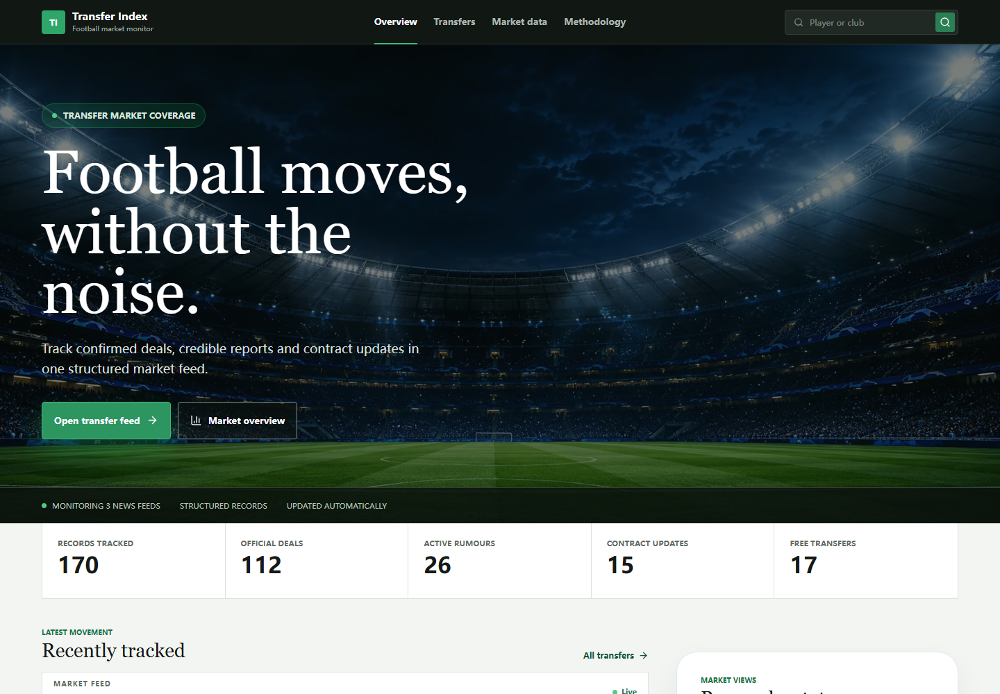
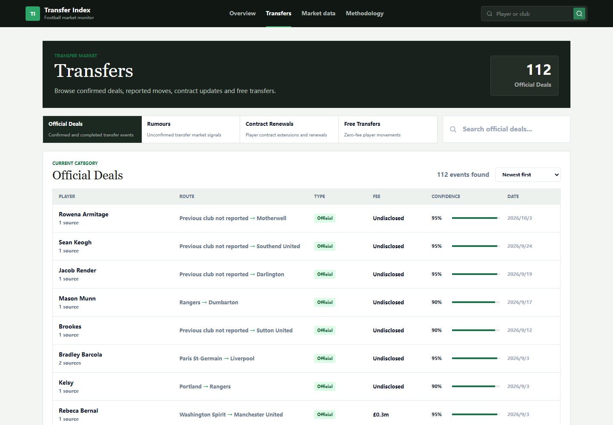
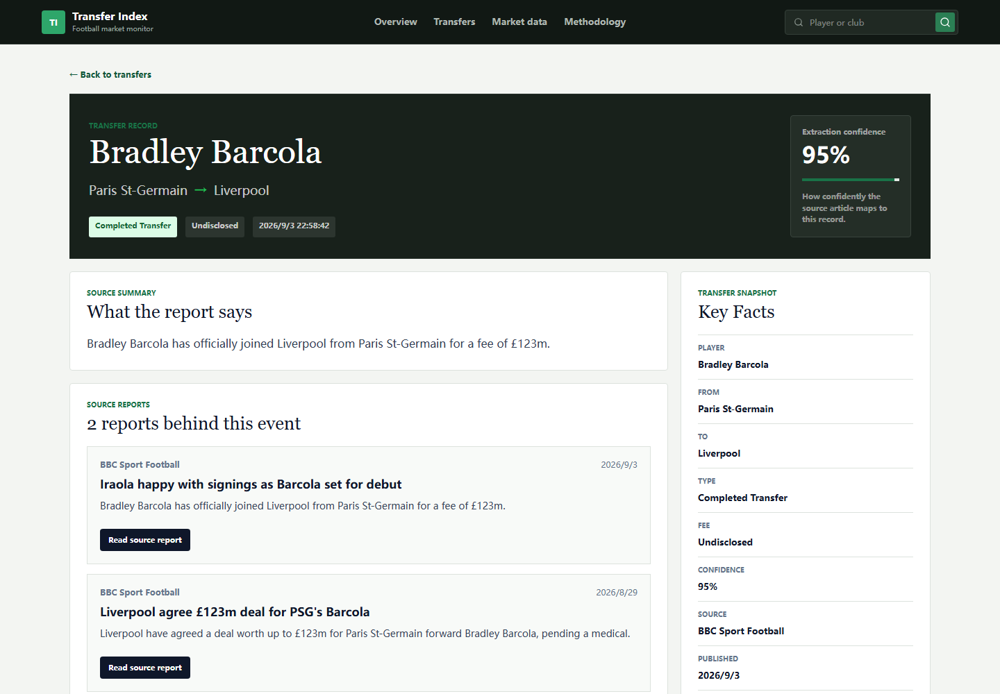
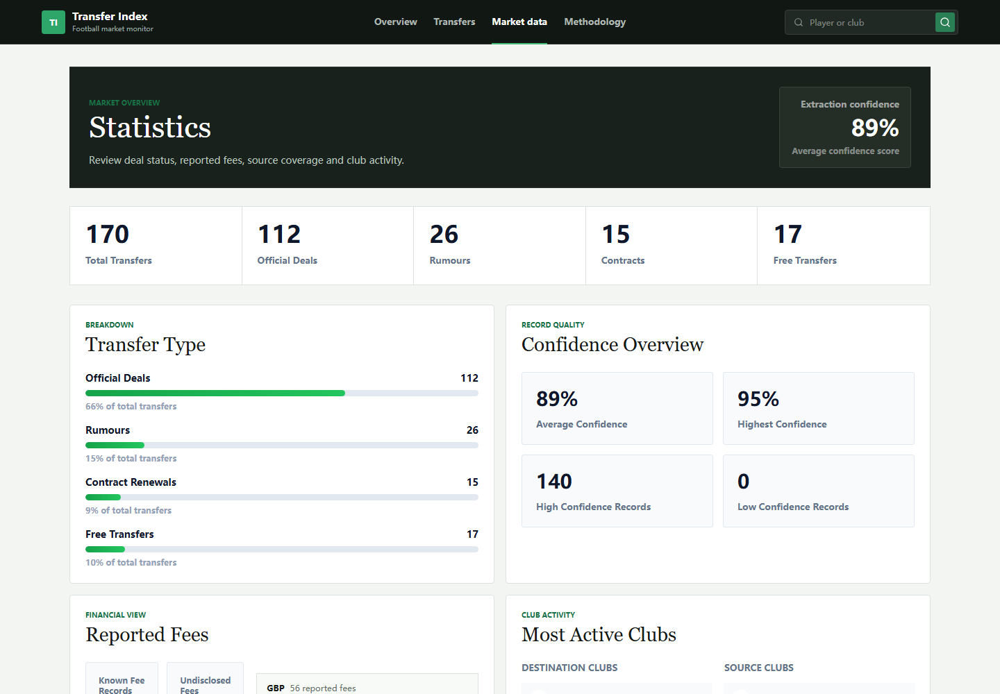
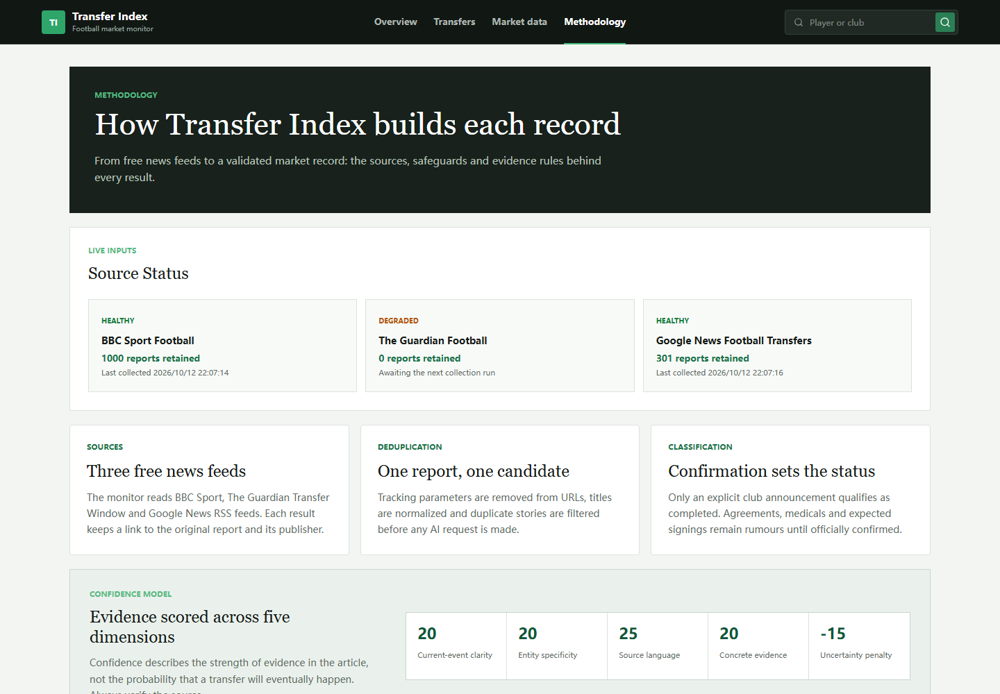

# AI Football Transfer Platform

[](https://github.com/liyang6620/AI-Football-Transfer-Platform/actions/workflows/ci.yml) [](https://github.com/liyang6620/AI-Football-Transfer-Platform/actions/workflows/codeql.yml) [](LICENSE)

## Overview

AI Football Transfer Platform is a full-stack web application that automatically collects football transfer news, extracts structured transfer information using Large Language Models, and presents the results through an interactive dashboard.

Traditional football news websites mainly provide unstructured articles that require manual reading to identify transfer details. This project aims to automate the entire pipeline from news collection to structured transfer intelligence.

The system periodically crawls football news from BBC Sport, The Guardian and Google News, retrieves article content, sends bounded inputs to the OpenAI API for semantic analysis, extracts structured transfer metadata, aggregates multiple reports into canonical events, and exposes the results through a RESTful API for a modern React frontend.

The project demonstrates practical experience in full-stack development, AI integration, backend services, data processing, REST API design, cloud deployment, and database management.

---

## Live Demo

Frontend

https://ai-football-transfer-platform.pages.dev

Backend API

https://football-transfer-api.onrender.com

The demo is a portfolio-grade market monitor, not an official transfer registry
or financial product. Records are generated from public reporting and should be
verified against the linked source before being treated as fact.



## Product Tour

| Transfer event feed | Multi-source event detail |
| --- | --- |
| Browse server-paginated events by status, search term and sort order. | Review the canonical event together with every retained source report. |
|  |  |

| Market analytics | Methodology and source health |
| --- | --- |
| Inspect event mix, extraction confidence, fees, club activity and reporting coverage. | See the live ingestion state and the evidence rules behind each record. |
|  |  |

---

## System Architecture

```
BBC Sport RSS + Guardian RSS + Google News RSS
          │
          ▼
News Crawler Service
          │
          ▼
Article Content Extraction
          │
          ▼
OpenAI Analysis
          │
          ▼
Event Aggregation
          │
          ▼
PostgreSQL Database
          │
          ▼
ASP.NET Core REST API
          │
          ▼
React Frontend
```

The application is composed of four major components:

- News crawling service
- AI analysis pipeline
- RESTful backend API
- React frontend dashboard

Each component is designed independently to improve maintainability and scalability.

---

## Key Features

### Automated News Collection

- Periodically crawl free football news feeds from BBC Sport, The Guardian and Google News
- Download complete article content instead of RSS summaries
- Filter likely transfer stories before AI processing
- Avoid duplicate articles using URL comparison
- Retain source-level provenance while merging duplicate reports into canonical events
- Record per-feed attempts, successful syncs, item counts and failure state
- Continue processing when one feed is temporarily unavailable
- Automatically schedule crawling through a background service

### AI-powered Information Extraction

The OpenAI model analyzes each article and extracts structured transfer information, including:

- Player Name
- Current Club
- Destination Club
- Transfer Type
- Estimated Transfer Fee
- Confidence Score
- AI-generated Summary

The prompt is specifically designed to distinguish genuine transfer news from historical references and unrelated football articles.

### Transfer Dashboard

The frontend categorizes transfers into multiple sections:

- Official Deals
- Transfer Rumours
- Contract Renewals
- Free Transfers

Each category supports sorting and filtering for easier exploration.

### Search

Users can search transfer news by:

- Player
- Club
- Article Title
- Keywords

### Transfer Details

Each transfer record contains

- All retained source reports and a primary source
- Publication date
- AI summary
- Confidence score
- Structured transfer information

### Background Processing

A hosted background service automatically performs:

1. News crawling
2. Article downloading
3. AI analysis
4. Database updates

No manual intervention is required after deployment.

---

## Technology Stack

### Frontend

- React
- Vite
- React Router
- Axios
- CSS3

### Backend

- ASP.NET Core 10
- Entity Framework Core
- RESTful API
- Background Hosted Services
- Dependency Injection

### AI

- OpenAI GPT API
- Prompt Engineering
- JSON Structured Output

### Database

- PostgreSQL
- Supabase

### Web Crawling

- CodeHollow FeedReader
- HtmlAgilityPack

### Deployment

Frontend

- Cloudflare Pages

Backend

- Render

Database

- Supabase PostgreSQL

---

## Database Design

The application stores news and extracted transfer information in PostgreSQL.

Main entities include:

### TransferNews

- Title
- Content
- Source
- URL
- PublishedAt
- AI Summary
- Extracted Player
- From Club
- To Club
- Transfer Type
- Estimated Fee
- Confidence
- Processing Status

### Transfer

- Stable event key derived from player, destination and event family
- Canonical player, route, transfer type, fee and confidence fields
- Primary report plus a one-to-many collection of supporting source reports

### SourceSyncState

- Feed URL and name
- Last attempt and successful sync timestamps
- Items seen during the latest run
- Sanitized failure type for public health reporting

The database is managed using Entity Framework Core Code First migrations.

---

## AI Processing Workflow

For every article, the backend performs the following steps:

1. Crawl RSS feed
2. Retrieve full article content
3. Clean HTML
4. Put extraction rules in a system message and the untrusted article in a separate user message
5. Send the request to `gpt-4o-mini` with a strict JSON Schema response format
6. Validate verbatim fee evidence against the supplied article
7. Enforce transfer, fee, currency, loan and confidence invariants
8. Save results into PostgreSQL
9. Attach the report to an existing canonical event or create a new event
10. Return paginated event data and retained source provenance through the REST API

The AI boundary is treated as untrusted input: empty or oversized articles are
handled safely, JSON parsing failures fall back to an `Unknown` result, and the
model must satisfy a strict schema with no additional properties. A reported
fee is accepted only when the model supplies a verbatim excerpt that occurs in
the article, contains the amount, and identifies the current player or one of
the relevant clubs. Wages, release clauses, valuations, historical fees and
fees for other players are rejected by deterministic server-side code.

Fees are stored in millions of their reported currency. A deterministic
post-processing rule converts grouped base-currency values such as `GBP 500,000`
to `0.5` before persistence, so model output cannot silently turn thousands into
hundreds of millions.

The post-processor guarantees these persistence invariants:

- contracts never carry transfer fees;
- free transfers store `0` with no currency;
- a missing fee always has a missing currency;
- positive fees require `GBP`, `EUR` or `USD` and cannot exceed 250 million;
- loans carry no fee unless the evidence explicitly identifies a loan fee;
- `Unknown` extractions never become public transfer events.

Multiple reports for the same event are merged without discarding known data.
Event type can advance from Rumour to Completed Transfer but cannot regress,
null values never overwrite known clubs or fees, the highest-confidence source
becomes primary, and publication time remains the newest across all sources.

Confidence is evidence-based rather than type-based. The model scores current-
event clarity, entity specificity, source language, and concrete deal details,
then applies a penalty for speculative wording. Scores are returned to two
decimal places so records reflect meaningful differences between official
announcements, detailed reports, and weak rumours.

---

## REST API

Public endpoints include:

```
GET /health
GET /ready
GET /api/transfers
GET /api/transfers/{id}
GET /api/transfers/search?keyword=arsenal
GET /api/transfers/stats
GET /api/sources/status
GET /openapi/v1.json
```

The main transfer endpoint supports server-side pagination, filtering, search
and sorting:

```http
GET /api/transfers?page=1&pageSize=25&category=rumours&search=arsenal&sort=confidence
```

It returns `items`, `page`, `pageSize`, `totalCount` and `totalPages`.
`category` accepts `official`, `rumours`, `contracts` or `free`; `sort`
accepts `newest`, `oldest`, `confidence` or `fee`. Page size is capped at 100.
Each item reports its `sourceCount`, while the detail endpoint includes source
titles, attribution, links and short summaries without exposing downloaded
article bodies. The public OpenAPI document describes the typed list, detail
and source-status contracts.

`/health` is a process-level liveness check used by the hosting platform.
`/ready` additionally verifies PostgreSQL connectivity and confirms that all
Entity Framework migrations have been applied. Database dependency failures
return HTTP 503 with a `Retry-After` header, while other unhandled server
errors use structured problem details.

---

## Local Development

### Clone Repository

```bash
git clone https://github.com/liyang6620/AI-Football-Transfer-Platform.git
```

### Backend

```bash
cd FootballTransfer.Api

dotnet restore
```

Set the required backend configuration before starting the API:

```powershell
$env:ConnectionStrings__DefaultConnection="Host=localhost;Port=5432;Database=football_transfer;Username=postgres;Password=postgres"
$env:OPENAI_API_KEY="your_api_key"
$env:AdminApiKey="generate_a_long_random_secret"
```

```bash
dotnet run
```

### Frontend

```bash
cd FootballTransfer.Frontend

npm ci

npm run dev
```

The frontend runs at `http://localhost:5173` by default and expects the local
API at `http://localhost:5262`. Override that address with
`VITE_API_BASE_URL` when required.

### Verification

Run the same checks enforced by GitHub Actions before opening a pull request:

```bash
dotnet build AI-Football-Transfer-Platform.slnx --configuration Release --warnaserror
dotnet test AI-Football-Transfer-Platform.slnx --configuration Release

cd FootballTransfer.Frontend
npm ci
npm run lint
npm test
npm run build
```

Validate the curated extraction benchmark without calling OpenAI:

```bash
node tools/evaluate-extraction.mjs
```

The default command validates 42 manually labelled positive, negative, and
production-regression cases only. To score results produced separately, pass a JSON file containing
one candidate result per case:

```bash
dotnet run --project FootballTransfer.Eval -- \
  evaluation/extraction-cases.json \
  evaluation/results/candidate-results.json

node tools/evaluate-extraction.mjs \
  evaluation/results/candidate-results.json \
  --out evaluation/results/score-YYYY-MM-DD.json
```

The scorer reports classification precision, recall and F1, overall and
per-field accuracy, every mismatch, and the IDs of any false-positive fees.
The real-model runner requires `OPENAI_API_KEY`; CI never invokes it.

### Real-model benchmark

The latest checked-in run used `gpt-4o-mini` on 21 October 2026. It evaluated
all 42 labelled cases through the same relevance filter, structured extraction,
evidence validator and post-processor used by the application.

| Metric | Result |
|---|---:|
| Classification precision | 100.00% |
| Classification recall | 80.00% |
| Classification F1 | 88.89% |
| Exact field accuracy | 95.92% |
| False-positive fees | 0 |

Per-field accuracy was 100.00% for player and loan detection, 97.62% for the
destination club, 95.24% for transfer type, and 92.86% for the source club,
fee and currency. The lower recall reflects a deliberately conservative
publication boundary: uncertain reports are withheld instead of being promoted
into public events. The candidate output and complete mismatch list are stored
in `evaluation/results/` so the result is reproducible and auditable.

Backend integration tests use PostgreSQL when `TEST_POSTGRES_CONNECTION` is
set. CI provisions a temporary PostgreSQL 16 service and validates that every
migration can be applied from an empty database.

---

## Environment Variables

### Backend

```
OPENAI_API_KEY=your_api_key

ConnectionStrings__DefaultConnection=your_postgresql_connection

AdminApiKey=generate_a_long_random_secret

Database__MigrateOnStartup=true

BackgroundJobs__Enabled=true
BackgroundJobs__InitialDelaySeconds=120
BackgroundJobs__IntervalHours=24
BackgroundJobs__BatchSize=10
BackgroundJobs__MaxBatchesPerRun=2
```

Administrative endpoints under `/api/ai`, `/api/crawler`, and `/api/news`
require the same value in the `X-Admin-Api-Key` request header. News routes are
private because they contain crawler inputs and full article text. Public
transfer responses expose only structured fields, a short AI summary, source
attribution, and the original article link.

### Frontend

```
VITE_API_BASE_URL=https://football-transfer-api.onrender.com
```

Never commit real database passwords or API keys. Configure them in the
deployment platform's encrypted environment-variable settings.

---

## Free Deployment

The live application uses free tiers from three providers:

| Component | Provider | Plan | Public URL |
| --- | --- | --- | --- |
| React frontend | Cloudflare Pages | Free | https://ai-football-transfer-platform.pages.dev |
| ASP.NET Core API | Render | Free web service | https://football-transfer-api.onrender.com |
| PostgreSQL | Supabase | Free | Private database connection |

The web hosting and database can run on free tiers for a small portfolio demo.
OpenAI API usage is billed separately and must be protected with processing
limits. Free-tier limits still apply: Render services spin down after
inactivity and may take 50 seconds or longer to wake, while inactive Supabase
projects may be paused and need to be resumed from the Supabase dashboard.

### 1. Create the Supabase Database

1. Create a free Supabase project in a region close to the Render service.
2. Open **Connect**, select the transaction pooler connection, and copy the
   PostgreSQL connection details.
3. The API applies pending Entity Framework migrations during startup by
   default. To apply them manually from a trusted local environment instead,
   set `Database__MigrateOnStartup=false` and run:

```bash
cd FootballTransfer.Api

# PowerShell
$env:ConnectionStrings__DefaultConnection="your_postgresql_connection"
dotnet ef database update
```

Current migrations retain unique source articles, derive stable transfer event
keys, attach duplicate reports to one canonical event and remove only duplicate
derived event rows. Original news records remain available as provenance.

The schema migration also enables PostgreSQL row-level security on every public
table without adding anonymous policies. Render connects as the database owner,
while Supabase `anon` and `authenticated` clients have no direct table access.
The browser communicates only with the documented Render API.

### 2. Deploy the API to Render

Create a free **Web Service** connected to this GitHub repository with these
settings:

```text
Runtime: Docker
Root Directory: FootballTransfer.Api
Branch: main
Instance Type: Free
```

Add these encrypted environment variables in Render:

```text
ConnectionStrings__DefaultConnection=<Supabase PostgreSQL connection>
OPENAI_API_KEY=<OpenAI API key>
AdminApiKey=<long random value>
```

Render automatically uses the repository's `Dockerfile` and listens on port
`8080`. The blueprint in `render.yaml` configures `/health` as the hosting
health check and limits each background-processing run. After deployment,
verify `/health`, `/ready`, and `/api/transfers` return HTTP 200.

### 3. Deploy the Frontend to Cloudflare Pages

Create a Pages project connected to the same repository:

```text
Framework preset: Vite
Root directory: FootballTransfer.Frontend
Build command: npm run build
Build output directory: dist
```

Set the production environment variable:

```text
VITE_API_BASE_URL=https://football-transfer-api.onrender.com
```

Both Render and Cloudflare Pages automatically redeploy after changes are
pushed to `main`.

The browser client allows 30 seconds for a request and retries one transient
network or gateway failure. During a Render cold start it shows an explicit
waking state; failed data is never presented as a genuine zero-value result.

### Administrative Endpoints

The following operations are intentionally unavailable without the Render
`AdminApiKey` value:

- all `/api/ai` endpoints
- all `/api/crawler` endpoints
- all `/api/news` endpoints

Send the key only from a trusted administration client:

For a small local dataset, the backwards-compatible admin-only
`POST /api/ai/reprocess-all` endpoint resets and rebuilds all derived records in
one request. Production rebuilds should use bounded batches to avoid request
timeouts and make progress observable:

```bash
curl -X POST \
  -H "X-Admin-Api-Key: $ADMIN_API_KEY" \
  https://football-transfer-api.onrender.com/api/ai/reset-for-reprocess

# Repeat until `processed` is 0.
curl -X POST \
  -H "X-Admin-Api-Key: $ADMIN_API_KEY" \
  https://football-transfer-api.onrender.com/api/ai/process-unprocessed/20

node tools/audit-live-data.mjs
```

The reset deletes derived `Transfers` and clears extracted news fields before
the batch rebuild. Run it during a quiet period because the public feed is
temporarily incomplete until all batches finish.

```bash
curl -X POST \
  -H "X-Admin-Api-Key: $ADMIN_API_KEY" \
  https://football-transfer-api.onrender.com/api/crawler/crawl
```

Do not expose this key through a `VITE_` variable because Vite embeds those
values into public browser bundles.

### Free-Tier Troubleshooting

- A slow first request usually means the Render free service is waking up.
- `/health` returning 200 while `/ready` returns 503 means the API process is
  running but PostgreSQL is unavailable or its schema is not current.
- PostgreSQL `tenant/user not found` errors usually mean the Supabase project
  is paused. Resume it from the Supabase project dashboard.
- A `401` response from an administrative endpoint means the
  `X-Admin-Api-Key` header is missing or incorrect.
- A `503` response from an administrative endpoint means `AdminApiKey` has not
  been configured on Render.

---

## Future Improvements

Several enhancements are planned for future versions:

- Player profile pages
- Club profile pages
- Player and club images
- Transfer timeline visualization
- AI confidence explanation
- Centralized production logging and alerting
- User accounts, favourites and notifications

---

## Project Highlights

This project demonstrates practical experience in:

- Full-stack web development
- REST API design
- Cloud deployment
- AI application integration
- Prompt engineering
- Database design
- Background services
- Web scraping
- PostgreSQL
- Entity Framework Core
- React application development

---

## Author

Yang Li

Auckland, New Zealand

---

## License

This project is released under the MIT License.
